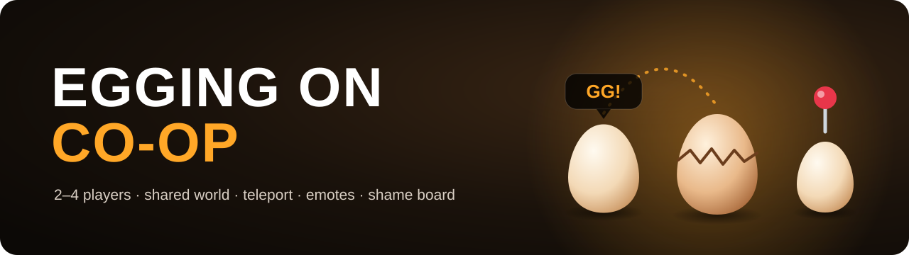

<p align="center"><a href="README.md">Русский</a> · <b>English</b></p>

<p align="center">
  
</p>

<p align="center">
  <a href="https://github.com/LiteS1de/egging-on-coop/releases/latest"></a>
</p>

<p align="center">
  <a href="https://github.com/LiteS1de/egging-on-coop/releases"></a>
  <a href="https://github.com/LiteS1de/egging-on-coop/releases"></a>
  
  
  
  <a href="LICENSE"></a>
</p>

<p align="center">
  A co-op mod for <a href="https://store.steampowered.com/app/2897610/Egging_On/">Egging On</a>: roll your eggs together with friends —<br>
  in one world, with teleports, emotes and an honest shame board.
</p>

> [!NOTE]
> The mod's in-game text is in Russian for now.

---

## Features

**Together in one world**
- **Friends nearby.** Up to 4 players: friends' eggs with their nick, distance and height. Bump into each other or pass through — the host decides.
- **Shared world.** Crates, buckets, pots, bottles and platforms are the same for everyone. The broken window, bell, microwave and pipe too.
- **Shared checkpoints.** A drone pad one player reaches opens for everyone (when the game's checkpoints are on).

**Playing together**
- **Teleport to a friend** — <kbd>T</kbd>. You drop gently onto your friend, nobody gets launched; with 2+ friends pick one with a number key.
- **Emotes** — hold <kbd>G</kbd>, hover an emote and release: it pops up over your egg.
- **Pings** — mouse wheel click: a ping where the camera looks, with your nick and the distance.
- **Shame board** — who fell the most, the worst fall, how many cracks. The totals show up on the end credits.

**For streamers**
- **Streamer mode** — open F9 on stream without worry: IP addresses and invite codes on screen turn into dots, so viewers never see your address or your friends'. "Copy" still copies the real address, so you can invite friends without turning it off. Through Steam no addresses are shown at all.
- **Viewer effects** for Twitch channel points and bits: wind, hop, moon gravity, slow motion, slippery egg, upside-down camera, teleports and more. Each has its own price, cooldown and switch; the mod creates the channel rewards itself and refunds points when an effect could not run.

**Connecting**
- **Through Steam:** the host invites friends from the Steam overlay, friends click "Join game". Traffic goes through Valve's relays: works behind any router, no Radmin, no port forwarding, nobody's IP is ever shown.
- Fallbacks: invite code, Radmin VPN or IP. If the internet blinks, a guest reconnects on its own.

## In action

<table>
  <tr>
    <td width="50%"><p align="center"><sub>Emote wheel and emotes over the eggs</sub></p></td>
    <td width="50%"><p align="center"><sub>Viewer effects: confetti, moon gravity, slow motion</sub></p></td>
  </tr>
  <tr>
    <td width="50%"><p align="center"><sub>Emotes on the move</sub></p></td>
    <td width="50%"><p align="center"><sub>Teleport to a friend — T</sub></p></td>
  </tr>
</table>

## Screenshots

<table>
  <tr>
    <td width="50%"><p align="center"><sub>Emotes over the eggs — a friend's and yours</sub></p></td>
    <td width="50%"><p align="center"><sub>A ping with the nick and the distance</sub></p></td>
  </tr>
  <tr>
    <td width="50%"><p align="center"><sub>Emote wheel — hold G</sub></p></td>
    <td width="50%"><p align="center"><sub>F9 → "Доска" (board): who fell how far</sub></p></td>
  </tr>
  <tr>
    <td width="50%"><p align="center"><sub>F9 → "Игра" (game): Steam invite, streamer mode hides addresses</sub></p></td>
    <td width="50%"><p align="center"><sub>F9 → "Стрим" (stream): Twitch viewer effects, prices and cooldowns</sub></p></td>
  </tr>
</table>

## Install

1. Download `EggCoop-<version>.zip` from [**Releases**](https://github.com/LiteS1de/egging-on-coop/releases/latest).
2. Unpack it anywhere and run **`Установить.bat`** ("Install").
3. Press **F9** in the game.

The script finds the game in your Steam libraries (or asks for the folder with `Egging On.exe`), installs the mod loader
[BepInEx 5.4.23.5](https://github.com/BepInEx/BepInEx) — it is already in the zip — and the mod itself. Your settings and other mods are left alone.

> [!TIP]
> **Update** with `Установить.bat` from the new zip (nick, keys and stats are kept). **Uninstall** with `Удалить.bat`.

> [!IMPORTANT]
> All players need **the same mod version** and the same game version. Joining through Steam needs **the Steam version** of the game on every PC. Details are in `Инструкция.txt` inside the zip (Russian).

## How to play

1. **Host:** F9 → nick → "Создать игру" (Host) → "Пригласить друзей через Steam" (invite through Steam).
2. **Friends:** accept the Steam invite or click "Join game" on the host in the Steam friends list. If the game is closed, Steam starts it.

Without Steam: the host copies the invite code or Radmin address under F9 → "Другие способы" (other ways); friends paste it there and click "Подключиться" (Join).

| Key | What it does |
|:---:|---|
| <kbd>F9</kbd> | co-op window: host / join, host settings, players, shame board, key bindings |
| <kbd>T</kbd> | teleport to a friend (with 2+ friends, pick one with a number key) |
| <kbd>G</kbd> (hold) | emote wheel: hover an emote and release, the × in the centre closes it |
| <kbd>mouse wheel</kbd> | ping where the camera is looking |
| <kbd>F10</kbd> | pause viewer effects |

Every key can be changed in F9 → "Настройки" (Settings).

<details>
<summary><b>Can't connect?</b></summary>

- The most reliable way is Steam: everyone runs the Steam version of the game, the host invites from F9.
- Without Steam: Radmin VPN for everyone, friends enter the host's Radmin address from F9 → "Другие способы" (other ways).
- Joining by code fails if the host runs a full-traffic VPN — the F9 window warns about it.
- Or the host forwards port **7788/UDP** on the router.
- The mod's log is `BepInEx\LogOutput.log` in the game folder: attach it to an [issue](https://github.com/LiteS1de/egging-on-coop/issues).

</details>

<details>
<summary><b>Building from source</b></summary>

You need the .NET SDK 8+ and the game with BepInEx 5 installed (the build references its `Assembly-CSharp.dll` and others; no game files are in this repository).

```bash
dotnet build src/EggCoop -c Release -p:GameDir="C:/Program Files (x86)/Steam/steamapps/common/Egging On"
dotnet run --project src/SelfTest
```

- `tools/lab.ps1 pack` builds the zip for players (`dist/EggCoop-<version>.zip`; BepInEx is downloaded and checked by SHA-256).
- `tools/lab.ps1 up` starts two copies of the game on one PC for testing (`lab/p1`, `lab/p2`, `-c Lab` configuration).
- `NOTES.md` is the log of decisions and test results.

</details>

## Licenses

The mod's code is [MIT](LICENSE). The zip also ships BepInEx 5.4.23.5 (MIT), LiteNetLib (MIT), Mono.Nat (MIT)
and [Twemoji](https://github.com/jdecked/twemoji) 15.1 emote images (CC-BY 4.0).
Egging On belongs to its authors; the mod contains no game files.
