<p align="center"><b>Русский</b> · <a href="README.en.md">English</a></p>

<p align="center">
  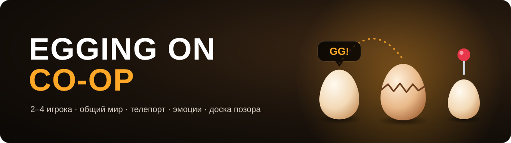
</p>

<p align="center">
  <a href="https://github.com/LiteS1de/egging-on-coop/releases/latest"></a>
</p>

<p align="center">
  <a href="https://github.com/LiteS1de/egging-on-coop/releases"></a>
  <a href="https://github.com/LiteS1de/egging-on-coop/releases"></a>
  
  
  
  <a href="LICENSE"></a>
</p>

<p align="center">
  Кооператив для <a href="https://store.steampowered.com/app/2897610/Egging_On/">Egging On</a>: катите яйца вместе с друзьями —<br>
  в одном мире, с телепортом, эмоциями и честной доской позора.
</p>

---

## Что умеет

**Вместе в одном мире**
- **Друзья рядом.** До 4 игроков: яйца друзей с ником, расстоянием и высотой над ними. Можно толкаться или проходить сквозь друг друга — решает хост.
- **Общий мир.** Ящики, вёдра, кастрюли, бутылки и платформы одни на всех. Разбитое окно, колокол, микроволновка и труба — тоже у всех.
- **Общие чекпоинты.** Площадка дрона, до которой добрался один, открывается у всех (если в игре включены чекпоинты).

**Общение**
- **Телепорт к другу** — клавиша <kbd>T</kbd>. Мягко падаете на друга, никого не выбивает; при 2+ друзьях — выбор цифрой.
- **Эмоции** — зажмите <kbd>G</kbd>, наведите мышь на картинку и отпустите: эмоция всплывёт над вашим яйцом.
- **Метки** — колёсико мыши: метка туда, куда смотрит камера, с ником и расстоянием.
- **Доска позора** — кто больше всех упал, худшее падение, сколько раз разбился. Итоги — на финальных титрах.

**Для стримеров**
- **Режим стримера** — можно спокойно открывать F9 в эфире: IP-адреса и коды приглашения на экране заменяются точками, и зрители не узнают ни ваш адрес, ни адреса друзей. Кнопка «Копировать» при этом копирует настоящий адрес, так что звать друзей можно не выключая режим. А через Steam адресов не видно вовсе.
- **Эффекты от зрителей** за баллы канала и bits Twitch: ветер, прыжок, лунная гравитация, замедление, скользкое яйцо, камера вверх ногами, телепорты и другие. Цена, откат и включение — у каждого свои; награды на канале мод создаёт сам и возвращает баллы, если эффект не смог сработать.

**Подключение**
- **Через Steam:** хост приглашает друзей из оверлея Steam, друзья жмут «Присоединиться к игре». Связь идёт через серверы Valve: работает за любым роутером, без Radmin и проброса портов, IP-адреса нигде не видны.
- Запасные способы — код приглашения, Radmin VPN или IP. Если интернет моргнул, гость переподключается сам.

## В деле

<table>
  <tr>
    <td width="50%">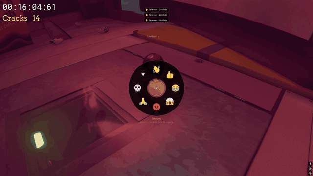<p align="center"><sub>Колесо эмоций и эмоции над яйцами</sub></p></td>
    <td width="50%">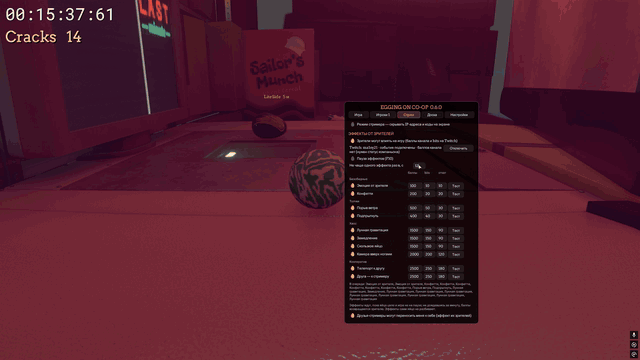<p align="center"><sub>Эффекты от зрителей: конфетти, лунная гравитация, замедление</sub></p></td>
  </tr>
  <tr>
    <td width="50%">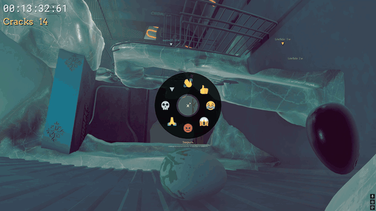<p align="center"><sub>Эмоции на ходу</sub></p></td>
    <td width="50%">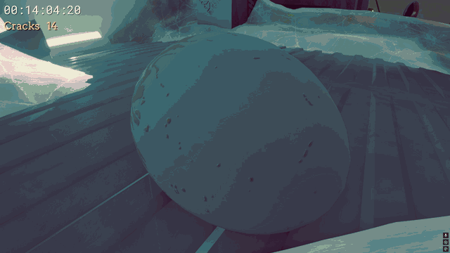<p align="center"><sub>Телепорт к другу — T</sub></p></td>
  </tr>
</table>

## Скриншоты

<table>
  <tr>
    <td width="50%">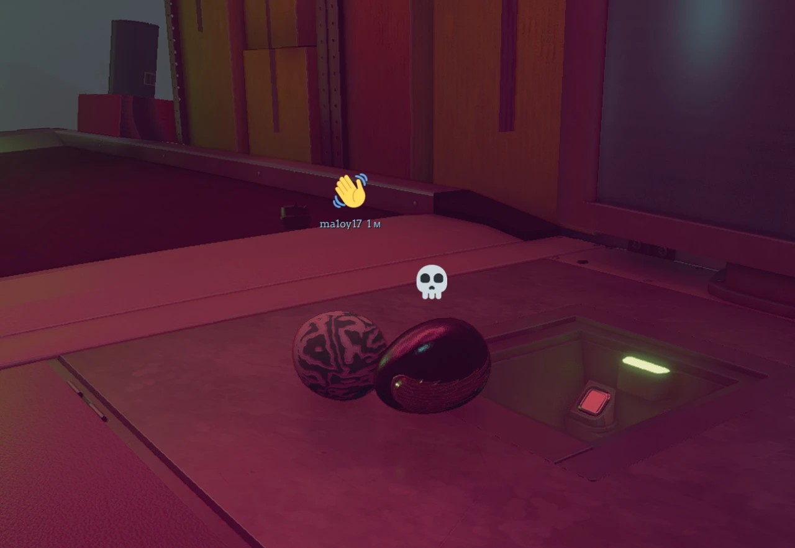<p align="center"><sub>Эмоции над яйцами — у друга и у вас</sub></p></td>
    <td width="50%">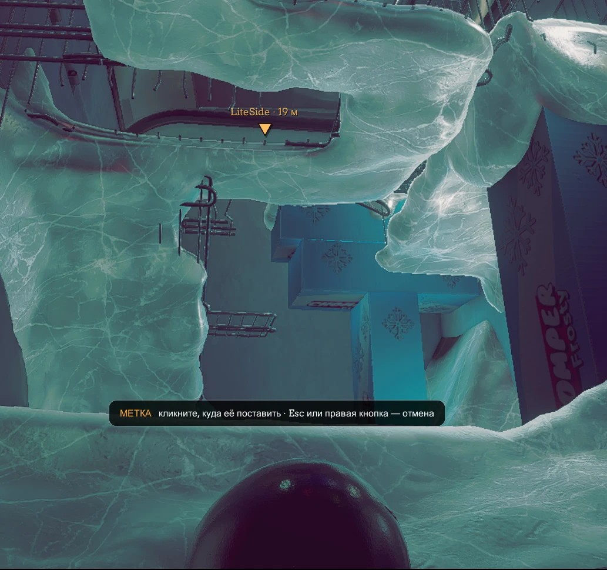<p align="center"><sub>Метка с ником и расстоянием</sub></p></td>
  </tr>
  <tr>
    <td width="50%">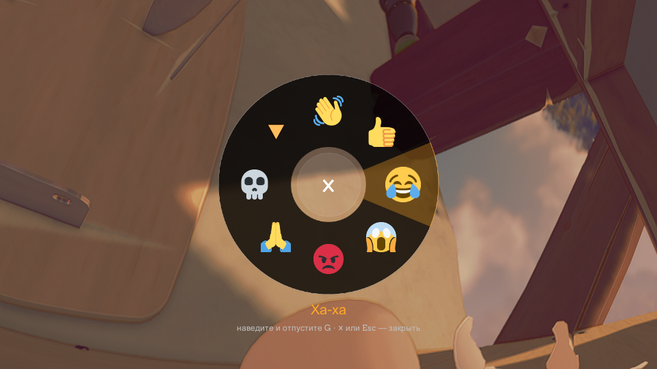<p align="center"><sub>Колесо эмоций — зажать G</sub></p></td>
    <td width="50%">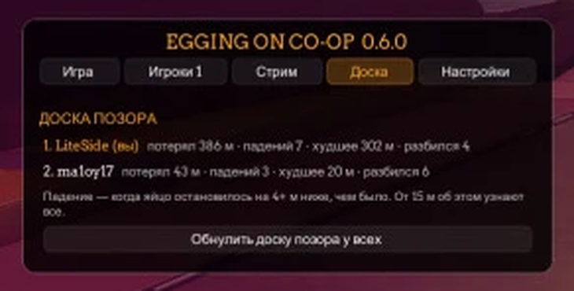<p align="center"><sub>F9 → «Доска»: кто сколько упал</sub></p></td>
  </tr>
  <tr>
    <td width="50%">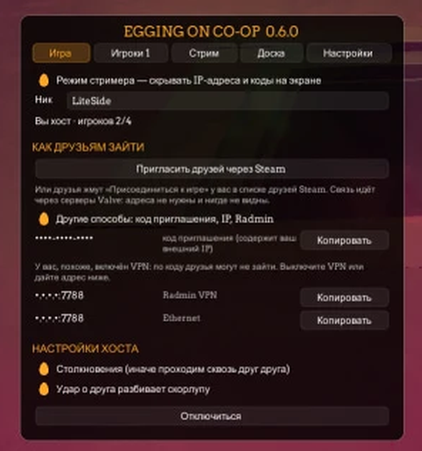<p align="center"><sub>F9 → «Игра»: приглашение через Steam, режим стримера прячет адреса</sub></p></td>
    <td width="50%">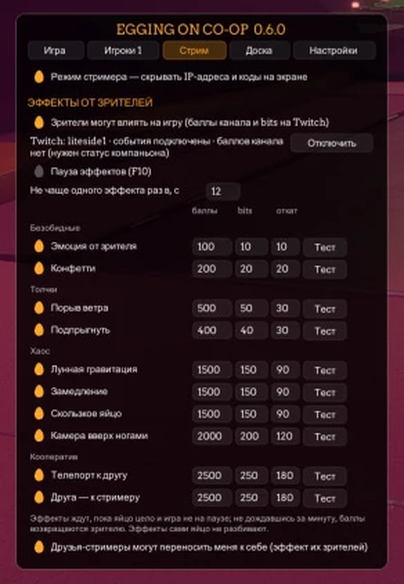<p align="center"><sub>F9 → «Стрим»: эффекты от зрителей Twitch, цены и откаты</sub></p></td>
  </tr>
</table>

## Установка

1. Скачайте `EggCoop-<версия>.zip` из [**Releases**](https://github.com/LiteS1de/egging-on-coop/releases/latest).
2. Распакуйте куда угодно и запустите **`Install.bat`**.
3. В игре нажмите **F9**.

Скрипт сам найдёт игру в Steam (или попросит выбрать папку с `Egging On.exe`), поставит загрузчик модов
[BepInEx 5.4.23.5](https://github.com/BepInEx/BepInEx) — он уже лежит в архиве — и сам мод. Ваши настройки и другие моды не трогаются.

> [!TIP]
> **Обновление** — тот же `Install.bat` из нового архива (ник, клавиши и статистика сохранятся). **Удаление** — `Uninstall.bat`.

> [!IMPORTANT]
> У всех игроков должна быть **одна и та же версия мода** и одна версия игры. Для входа через Steam у всех должна быть **Steam-версия** игры. Подробности — в `Инструкция.txt` внутри архива.

## Как играть

1. **Хост:** F9 → ник → «Создать игру» → «Пригласить друзей через Steam».
2. **Друзья:** принимают приглашение в Steam или жмут «Присоединиться к игре» у хоста в списке друзей. Если игра закрыта, Steam сам её запустит.

Без Steam: хост в F9 → «Другие способы» копирует код приглашения или Radmin-адрес, друзья вставляют его там же и жмут «Подключиться».

| Клавиша | Что делает |
|:---:|---|
| <kbd>F9</kbd> | окно кооператива: создать игру / подключиться, настройки хоста, игроки, доска позора, клавиши |
| <kbd>T</kbd> | телепорт к другу (при 2+ друзьях — выбор цифрой) |
| <kbd>G</kbd> (зажать) | колесо эмоций: навести мышь и отпустить, × в центре — закрыть |
| <kbd>колёсико мыши</kbd> | метка там, куда смотрит камера |
| <kbd>F10</kbd> | пауза эффектов от зрителей |

Все клавиши меняются в F9 → «Настройки». Там же язык мода: по умолчанию как у Windows, русский или английский.

<details>
<summary><b>Не подключается?</b></summary>

- Самое надёжное — через Steam: у всех запущена Steam-версия игры, хост приглашает из F9.
- Без Steam — Radmin VPN у всех: друг вводит Radmin-адрес хоста из F9 → «Другие способы».
- Вход по коду не сработает, если у хоста включён VPN на весь трафик — окно F9 предупредит.
- Или хост пробрасывает на роутере порт **7788/UDP**.
- Лог мода — `BepInEx\LogOutput.log` в папке игры: приложите его к [issue](https://github.com/LiteS1de/egging-on-coop/issues).

</details>

<details>
<summary><b>Сборка из исходников</b></summary>

Нужны .NET SDK 8+ и установленная игра с BepInEx 5 (сборка ссылается на её `Assembly-CSharp.dll` и др.; файлов игры в репозитории нет).

```bash
dotnet build src/EggCoop -c Release -p:GameDir="C:/Program Files (x86)/Steam/steamapps/common/Egging On"
dotnet run --project src/SelfTest
```

- `tools/lab.ps1 pack` — архив для раздачи (`dist/EggCoop-<версия>.zip`; BepInEx скачивается и проверяется по SHA-256).
- `tools/lab.ps1 up` — две копии игры на одном ПК для тестов (`lab/p1`, `lab/p2`, конфигурация `-c Lab`).
- `NOTES.md` — журнал решений и проверок.

</details>

## Лицензии

Код мода — [MIT](LICENSE). В архиве также: BepInEx 5.4.23.5 (MIT), LiteNetLib (MIT), Mono.Nat (MIT),
картинки эмоций [Twemoji](https://github.com/jdecked/twemoji) 15.1 (CC-BY 4.0).
Egging On принадлежит её авторам; мод не содержит файлов игры.
