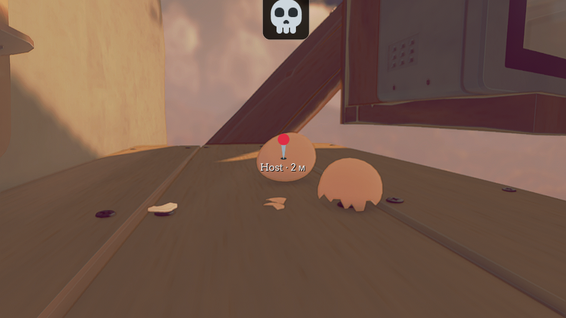
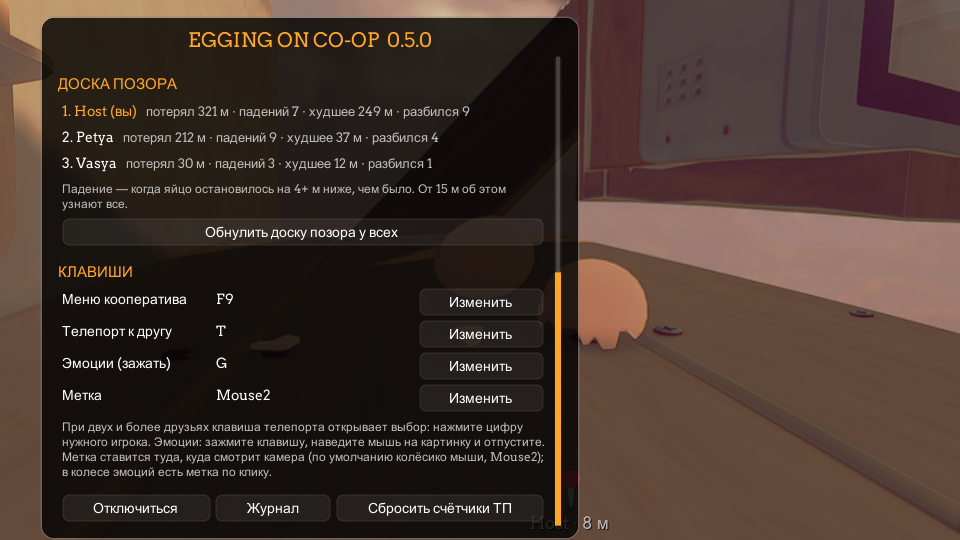

<p align="center"><b>Русский</b> · <a href="README.en.md">English</a></p>

<p align="center">
  
</p>

<p align="center">
  <a href="https://github.com/LiteS1de/egging-on-coop/releases/latest"></a>
</p>

<p align="center">
  <a href="https://github.com/LiteS1de/egging-on-coop/releases"></a>
  <a href="https://github.com/LiteS1de/egging-on-coop/releases"></a>
  
  
  
  <a href="LICENSE"></a>
</p>

<p align="center">
  Кооператив для <a href="https://store.steampowered.com/app/2897610/Egging_On/">Egging On</a>: катите яйца вместе с друзьями —<br>
  в одном мире, с телепортом, эмоциями и честной доской позора.
</p>

---

## ✨ Что умеет

| | |
|---|---|
| 🥚 **Друзья в вашем мире** | до 4 игроков: яйца друзей с ником, расстоянием и высотой над ними; можно толкаться (или проходить сквозь — решает хост) |
| 🌍 **Общий мир** | ящики, вёдра, кастрюли, бутылки, платформы — одни на всех; разбитое окно, колокол, микроволновка и труба — у всех |
| 🚁 **Общие чекпоинты** | площадка дрона, до которой добрался один, открывается у всех (если в игре включены чекпоинты) |
| ⚡ **Телепорт к другу** | клавиша **T**: мягко падаете на друга, без выбиваний; при 2+ друзьях — выбор цифрой |
| 😂 **Эмоции** | зажмите **G**, наведите мышь на картинку и отпустите — эмоция всплывёт над вашим яйцом |
| 📍 **Метки** | колёсико мыши — метка туда, куда смотрит камера, с ником и расстоянием |
| 💀 **Доска позора** | кто больше всех упал, худшее падение, сколько раз разбился; итоги — на финальных титрах |
| 🔌 **Подключение** | код приглашения, Radmin VPN или IP; гость сам переподключается, если интернет моргнул |

## 📸 Скриншоты

<table>
  <tr>
    <td width="50%"><p align="center"><sub>Колесо эмоций — зажать G</sub></p></td>
    <td width="50%"><p align="center"><sub>Метка и эмоция над яйцом</sub></p></td>
  </tr>
  <tr>
    <td colspan="2"><p align="center"><sub>Окно F9: доска позора и клавиши</sub></p></td>
  </tr>
</table>

## 📦 Установка

1. Скачайте `EggCoop-<версия>.zip` из [**Releases**](https://github.com/LiteS1de/egging-on-coop/releases/latest).
2. Распакуйте куда угодно и запустите **`Установить.bat`**.
3. В игре нажмите **F9**.

Скрипт сам найдёт игру в Steam (или попросит выбрать папку с `Egging On.exe`), поставит загрузчик модов
[BepInEx 5.4.23.5](https://github.com/BepInEx/BepInEx) — он уже лежит в архиве — и сам мод. Ваши настройки и другие моды не трогаются.

> [!TIP]
> **Обновление** — тот же `Установить.bat` из нового архива (ник, клавиши и статистика сохранятся). **Удаление** — `Удалить.bat`.

> [!IMPORTANT]
> У всех игроков должна быть **одна и та же версия мода** и одна версия игры. Подробности — в `Инструкция.txt` внутри архива.

## 🎮 Как играть

1. **Хост:** F9 → ник → «Создать игру» → «Копировать» код приглашения или Radmin-адрес и отправить друзьям.
2. **Друзья:** F9 → ник → вставить код или адрес → «Подключиться».

| Клавиша | Что делает |
|:---:|---|
| <kbd>F9</kbd> | окно кооператива: создать игру / подключиться, настройки хоста, игроки, доска позора, клавиши |
| <kbd>T</kbd> | телепорт к другу (при 2+ друзьях — выбор цифрой) |
| <kbd>G</kbd> (зажать) | колесо эмоций: навести мышь и отпустить, × в центре — закрыть |
| <kbd>колёсико мыши</kbd> | метка там, куда смотрит камера |

Все клавиши меняются в F9 → «Клавиши».

<details>
<summary><b>🔧 Не подключается?</b></summary>

- Самое надёжное — Radmin VPN у всех: друг вводит Radmin-адрес хоста из окна F9.
- Вход по коду не сработает, если у хоста включён VPN на весь трафик — окно F9 предупредит.
- Или хост пробрасывает на роутере порт **7788/UDP**.
- Лог мода — `BepInEx\LogOutput.log` в папке игры: приложите его к [issue](https://github.com/LiteS1de/egging-on-coop/issues).

</details>

<details>
<summary><b>🛠 Сборка из исходников</b></summary>

Нужны .NET SDK 8+ и установленная игра с BepInEx 5 (сборка ссылается на её `Assembly-CSharp.dll` и др.; файлов игры в репозитории нет).

```bash
dotnet build src/EggCoop -c Release -p:GameDir="C:/Program Files (x86)/Steam/steamapps/common/Egging On"
dotnet run --project src/SelfTest
```

- `tools/lab.ps1 pack` — архив для раздачи (`dist/EggCoop-<версия>.zip`; BepInEx скачивается и проверяется по SHA-256).
- `tools/lab.ps1 up` — две копии игры на одном ПК для тестов (`lab/p1`, `lab/p2`, конфигурация `-c Lab`).
- `NOTES.md` — журнал решений и проверок.

</details>

## 📄 Лицензии

Код мода — [MIT](LICENSE). В архиве также: BepInEx 5.4.23.5 (MIT), LiteNetLib (MIT), Mono.Nat (MIT),
картинки эмоций [Twemoji](https://github.com/jdecked/twemoji) 15.1 (CC-BY 4.0).
Egging On принадлежит её авторам; мод не содержит файлов игры.
